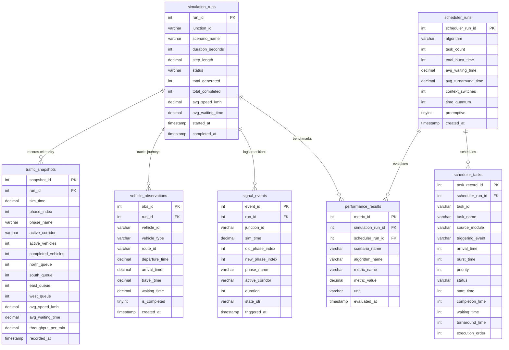

# Smart Traffic Simulator — Database Schema Specification

## 1. Relational Database Overview

The project uses **MySQL 8.0** with the `InnoDB` storage engine to provide full ACID compliance, foreign key constraint enforcement, and transactional integrity.

The database name is `smart_traffic_db` (configurable via `.env`).

---

## 2. Entity-Relationship Diagram

---

## 3. Table Specifications

### 3.1 `simulation_runs`
Stores high-level metadata and aggregate outcomes of each SUMO execution.
- `run_id` (INT, AUTO_INCREMENT, PRIMARY KEY): Unique run identifier.
- `junction_id` (VARCHAR(32), NOT NULL, DEFAULT 'J0'): Junction identifier for scalability.
- `scenario_name` (VARCHAR(64), NOT NULL): Scenario name ('Low Demand', 'Medium Demand', 'High Demand').
- `duration_seconds` (INT, NOT NULL): Target simulation duration.
- `step_length` (DECIMAL(4,2), NOT NULL, DEFAULT 1.00): TraCI step length in seconds.
- `status` (VARCHAR(32), NOT NULL, DEFAULT 'COMPLETED'): Execution status ('RUNNING', 'COMPLETED', 'FAILED').
- `total_generated` (INT, NOT NULL, DEFAULT 0): Total vehicles injected.
- `total_completed` (INT, NOT NULL, DEFAULT 0): Total vehicles that completed their journey.
- `avg_speed_kmh` (DECIMAL(6,2), NOT NULL, DEFAULT 0.00): Mean network vehicle speed.
- `avg_waiting_time` (DECIMAL(8,2), NOT NULL, DEFAULT 0.00): Mean vehicle waiting delay.
- `started_at` (TIMESTAMP, NOT NULL, DEFAULT CURRENT_TIMESTAMP): Run initiation timestamp.
- `completed_at` (TIMESTAMP, NULL): Run termination timestamp.

### 3.2 `traffic_snapshots`
Periodic high-frequency telemetry capturing intersection queue lengths, active vehicles, and speeds.
- `snapshot_id` (INT, AUTO_INCREMENT, PRIMARY KEY): Unique snapshot identifier.
- `run_id` (INT, NOT NULL, FOREIGN KEY): References `simulation_runs(run_id)` ON DELETE CASCADE.
- `sim_time` (DECIMAL(8,2), NOT NULL): Current simulation time in seconds.
- `phase_index` (INT, NOT NULL): Traffic light phase index (0 to 5).
- `phase_name` (VARCHAR(64), NOT NULL): Name of active phase.
- `active_corridor` (VARCHAR(64), NOT NULL): Active green corridor.
- `active_vehicles` (INT, NOT NULL): Number of vehicles currently traveling.
- `completed_vehicles` (INT, NOT NULL): Total vehicles that arrived at destination.
- `north_queue`, `south_queue`, `east_queue`, `west_queue` (INT, NOT NULL): Count of stopped vehicles (speed < 0.1 m/s) on each inbound approach.
- `avg_speed_kmh` (DECIMAL(6,2), NOT NULL): Instantaneous average speed.
- `avg_waiting_time` (DECIMAL(8,2), NOT NULL): Instantaneous average waiting delay.
- `throughput_per_min` (DECIMAL(6,2), NOT NULL): Completed vehicles per simulation minute.

### 3.3 `vehicle_observations`
Fine-grained journey records for individual vehicles entering and traversing the junction.
- `obs_id` (INT, AUTO_INCREMENT, PRIMARY KEY): Unique observation identifier.
- `run_id` (INT, NOT NULL, FOREIGN KEY): References `simulation_runs(run_id)` ON DELETE CASCADE.
- `vehicle_id` (VARCHAR(64), NOT NULL): Vehicle identifier assigned by TraCI.
- `vehicle_type` (VARCHAR(32), NOT NULL): Physical type ('passenger', 'bus', 'delivery', 'emergency').
- `route_id` (VARCHAR(64), NOT NULL): Origin-destination route taken.
- `departure_time` (DECIMAL(8,2), NOT NULL): Simulation time when vehicle departed.
- `arrival_time` (DECIMAL(8,2), NULL): Simulation time when vehicle reached destination edge.
- `travel_time` (DECIMAL(8,2), NULL): Total trip time in seconds.
- `waiting_time` (DECIMAL(8,2), NOT NULL, DEFAULT 0.00): Accumulated time vehicle was queued.
- `is_completed` (TINYINT(1), NOT NULL, DEFAULT 0): 1 if trip was completed, 0 if still active when simulation stopped.

### 3.4 `signal_events`
Audit log of every traffic light state change, duration, and active corridor.
- `event_id` (INT, AUTO_INCREMENT, PRIMARY KEY): Unique event identifier.
- `run_id` (INT, NOT NULL, FOREIGN KEY): References `simulation_runs(run_id)` ON DELETE CASCADE.
- `junction_id` (VARCHAR(32), NOT NULL, DEFAULT 'J0'): Junction identifier.
- `sim_time` (DECIMAL(8,2), NOT NULL): Simulation time when phase change occurred.
- `old_phase_index`, `new_phase_index` (INT, NOT NULL): Phase transition indices.
- `phase_name` (VARCHAR(64), NOT NULL): Transitioned phase description.
- `active_corridor` (VARCHAR(64), NOT NULL): Active green corridor.
- `duration` (INT, NOT NULL): Scheduled duration of the phase in seconds.
- `state_str` (VARCHAR(32), NOT NULL): 16-character SUMO traffic light state string.

### 3.5 `scheduler_runs`
Tracks executions of user-space CPU scheduling algorithms (FCFS, Priority, Round Robin).
- `scheduler_run_id` (INT, AUTO_INCREMENT, PRIMARY KEY): Unique run identifier.
- `algorithm` (VARCHAR(32), NOT NULL): Algorithm name ('FCFS', 'Priority (Non-Preemptive)', 'Round Robin (q=2)').
- `task_count` (INT, NOT NULL): Total tasks evaluated.
- `total_burst_time` (INT, NOT NULL): Sum of burst times across all tasks.
- `avg_waiting_time` (DECIMAL(8,2), NOT NULL): Mean task waiting time.
- `avg_turnaround_time` (DECIMAL(8,2), NOT NULL): Mean task turnaround time.
- `context_switches` (INT, NOT NULL): Total CPU context switches recorded.
- `time_quantum` (INT, NULL): Time quantum if Round Robin, else NULL.
- `preemptive` (TINYINT(1), NOT NULL, DEFAULT 0): 1 if preemptive, 0 if non-preemptive.

### 3.6 `scheduler_tasks`
Individual simulated OS processes created by traffic monitoring and system operations.
- `task_record_id` (INT, AUTO_INCREMENT, PRIMARY KEY): Unique record identifier.
- `scheduler_run_id` (INT, NOT NULL, FOREIGN KEY): References `scheduler_runs(scheduler_run_id)` ON DELETE CASCADE.
- `task_id` (VARCHAR(32), NOT NULL): Identifier ('T1', 'T2', etc.).
- `task_name` (VARCHAR(128), NOT NULL): Operational description.
- `source_module` (VARCHAR(64), NOT NULL): Originating Python module.
- `triggering_event` (VARCHAR(128), NOT NULL): Physical or software event that created the task.
- `arrival_time` (INT, NOT NULL): Arrival time in ready queue.
- `burst_time` (INT, NOT NULL): Required CPU execution ticks.
- `priority` (INT, NOT NULL): Priority level (1 = highest).
- `status` (VARCHAR(32), NOT NULL, DEFAULT 'COMPLETED'): Final task lifecycle state.
- `start_time` (INT, NOT NULL): First time task acquired the CPU.
- `completion_time` (INT, NOT NULL): Time when task finished execution.
- `waiting_time` (INT, NOT NULL): Turnaround time minus burst time.
- `turnaround_time` (INT, NOT NULL): Completion time minus arrival time.
- `execution_order` (INT, NOT NULL): Ordinal dispatch sequence.

### 3.7 `performance_results`
Cross-system benchmarking linking traffic scenarios, scheduler performance, and DBMS metrics.
- `metric_id` (INT, AUTO_INCREMENT, PRIMARY KEY): Unique metric identifier.
- `simulation_run_id` (INT, NULL, FOREIGN KEY): References `simulation_runs(run_id)` ON DELETE SET NULL.
- `scheduler_run_id` (INT, NULL, FOREIGN KEY): References `scheduler_runs(scheduler_run_id)` ON DELETE SET NULL.
- `scenario_name` (VARCHAR(64), NOT NULL): Scenario name.
- `algorithm_name` (VARCHAR(32), NOT NULL): Algorithm evaluated.
- `metric_name` (VARCHAR(64), NOT NULL): Metric name ('Avg Waiting Time', 'Throughput', etc.).
- `metric_value` (DECIMAL(10,2), NOT NULL): Numeric result value.
- `unit` (VARCHAR(32), NOT NULL): Unit of measure ('seconds', 'ticks', 'veh/min').
